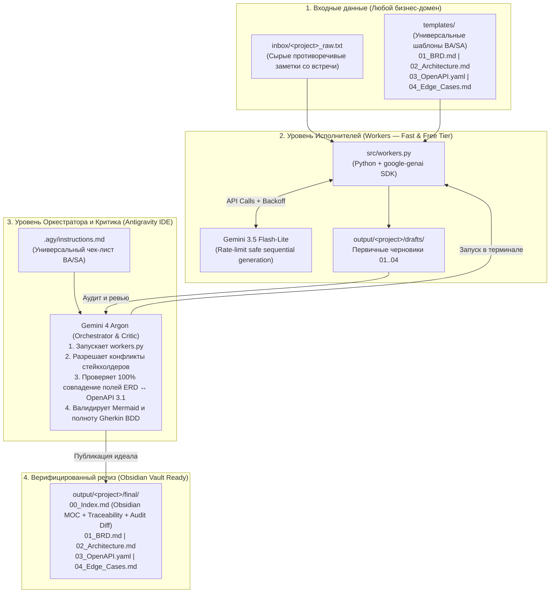

# SA-Spec-Pipeline: Universal AI Assistant for Business & Systems Analysts (BA/SA)

[](#архитектура-orchestrator-worker)
[](#структура-проекта)
[](#быстрый-старт)
[](#структура-проекта)

**SA-Spec-Pipeline** — это универсальный open-source AI-помощник для бизнес- и системных аналитиков (**BA/SA**) на базе агентного паттерна **Orchestrator-Worker**.

Инструмент не привязан к конкретной отрасли — он подходит для **любого домена** (E-Commerce, FinTech, Логистика, Бронирование, MedTech, HR-Tech, SaaS) и автоматически превращает сырые, противоречивые заметки со встреч с заказчиком (`inbox/<project>_raw.txt`) в полный, согласованный комплект документации промышленного уровня:
1. **BRD (`01_BRD.md`)** — бизнес-цели, скоуп MVP, функциональные/нефункциональные требования, доменные инварианты (`BR-*`) и **реестр выявленных противоречий** с решениями аналитика.
2. **System Architecture (`02_Architecture.md`)** — компонентная архитектура, **Mermaid ERD**, **State Machine** и **Sequence-диаграммы**, спроектированные под сущности вашего проекта.
3. **API Contract (`03_OpenAPI.yaml`)** — строгая спецификация **OpenAPI 3.1.0**, синхронизированная до каждого поля, типа и статуса с ERD.
4. **Edge Cases & BDD (`04_Edge_Cases.md`)** — матрица отказов, гонок (*race conditions*), граничных условий и приемочные сценарии **Gherkin**.
5. **Obsidian Index (`00_Index.md`)** — граф связей (MOC), сквозная матрица трассируемости (`FR -> BR -> Entity -> Endpoint -> Gherkin`) и отчет критика (**Audit Diff Report**).

---

## Архитектура Orchestrator-Worker

Пайплайн разделяет когнитивную нагрузку между быстрыми легковесными моделями-исполнителями (**Workers**) и флагманской моделью-оркестратором (**Orchestrator & Critic**):



### Почему именно Orchestrator-Worker?
| Уровень | Компонент / Модель | Роль в пайплайне | Преимущество |
| :--- | :--- | :--- | :--- |
| **Workers (Исполнители)** | `src/workers.py` + `gemini-3.5-flash-lite` | Быстрая первичная структуризация сырого текста по 4 универсальным шаблонам с соблюдением лимитов бесплатного API | Минимальная стоимость токенов, быстрая генерация чернового каркаса под любой домен |
| **Orchestrator & Critic (Оркестратор)** | **Gemini 4 Argon** (в среде Antigravity) | Глубокий архитектурный аудит: сверка типов данных между `erDiagram` и `OpenAPI 3.1`, разрешение бизнес-коллизий, проверка синтаксиса диаграмм и крайних сценариев | Отсутствие галлюцинаций, 100% сквозная трассируемость от бизнес-требования до автотеста |

---

## Структура проекта

```text
sa-spec-pipeline/
├── .agy/
│   └── instructions.md             # Универсальная инструкция и чек-лист Оркестратора (Gemini 4 Argon)
├── inbox/                          # Входящие сырые заметки со встреч (любые домены)
│   ├── payment_gateway_raw.txt     # Кейс 1 (FinTech): Сервис рекуррентных подписок и эквайринга
│   └── room_booking_raw.txt        # Кейс 2 (PropTech/HR): Система бронирования переговорных комнат
├── src/
│   └── workers.py                  # Универсальный Python-скрипт воркеров (google-genai SDK)
├── templates/                      # Доменно-независимые шаблоны BA/SA
│   ├── 01_BRD.md                   # Шаблон бизнес- и функциональных требований + лог противоречий
│   ├── 02_Architecture.md          # Шаблон архитектуры (Mermaid ERD, State Machine, Sequence)
│   ├── 03_OpenAPI.yaml             # Шаблон контракта REST API & Webhooks (OpenAPI 3.1.0)
│   └── 04_Edge_Cases.md            # Шаблон матрицы граничных сценариев и BDD Gherkin-тестов
├── output/
│   └── <project_name>/
│       ├── drafts/                 # Сырые черновики от воркера (gemini-3.5-flash-lite)
│       └── final/                  # Проверенные и доведенные до идеала спецификации + 00_Index.md
├── .env.example                    # Пример конфигурации переменных окружения
├── requirements.txt                # Зависимости Python (google-genai, python-dotenv, pyyaml)
└── README.md                       # Документация проекта
```

---

## Быстрый старт

### 1. Установка зависимостей
```bash
python3 -m venv .venv
source .venv/bin/activate
pip install -r requirements.txt
```

### 2. Настройка API-ключа
Скопируйте `.env.example` в `.env` и укажите ваш бесплатный ключ из [Google AI Studio](https://aistudio.google.com/app/apikey):
```bash
cp .env.example .env
```

### 3. Запуск на любом вашем проекте
Положите сырую расшифровку встречи в `inbox/my_project_raw.txt` и попросите **Gemini 4 Argon** в чате Antigravity:
> *«Запусти пайплайн по инструкции `.agy/instructions.md` для файла `inbox/my_project_raw.txt`»*

Или запустите генерацию черновиков вручную через CLI:
```bash
.venv/bin/python src/workers.py inbox/room_booking_raw.txt
```
