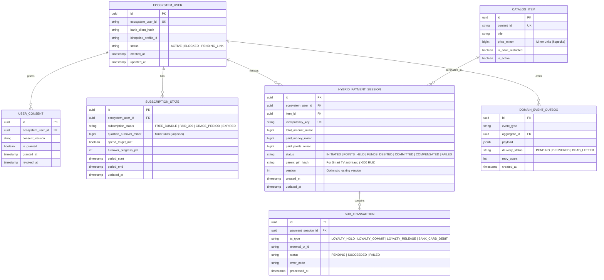
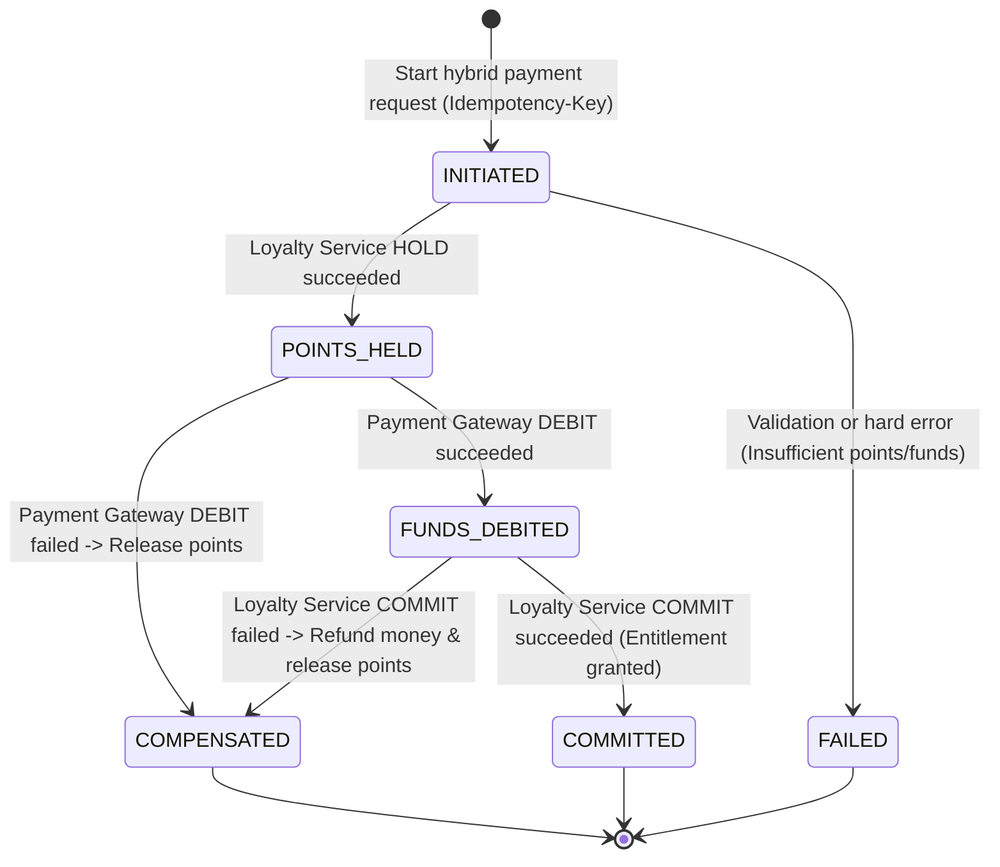
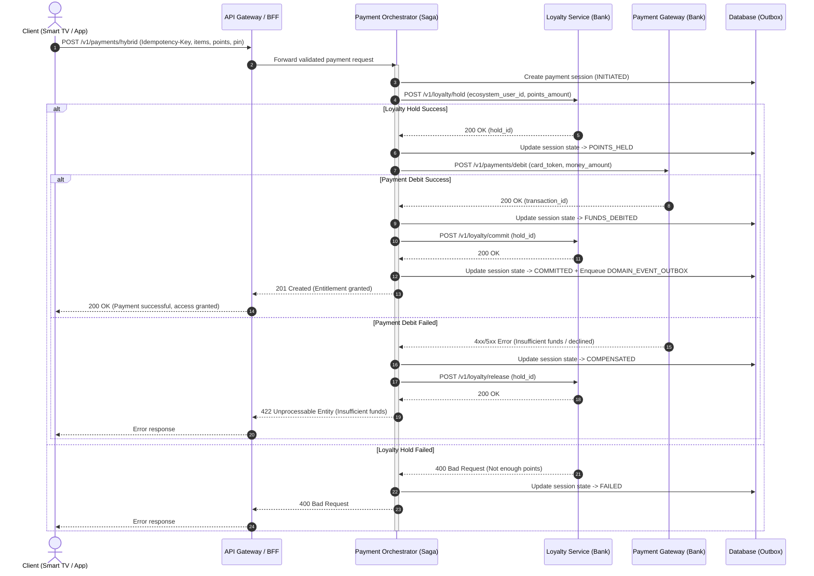
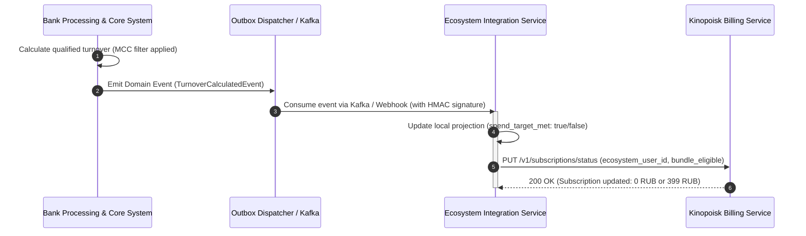

# System Architecture & Data Model: bank_kinopoisk

> **Document Status:** Verified & Refined  
> **Version:** 1.0  
> **Related BRD:** `01_BRD.md`  
> **Related API Contract:** `03_OpenAPI.yaml`

---

## 1. Architectural Overview & Design Principles
### 1.1 Architectural Style & Patterns
Проект **bank_kinopoisk** реализуется в рамках гибридной экосистемной архитектуры (FinTech x Media Bundle), сочетающей микросервисный подход и событийно-ориентированную интеграцию (Event-Driven Architecture). 
* **Шлюз экосистемы (Ecosystem Media-Banking Integration Service):** Изолирует медиа-платформу Кинопоиска от прямого доступа к Core Banking System (АБС) Банка, выполняя функции кэширования статусов подписок и оркестрации запросов.
* **Паттерн Saga (Оркестрация):** Применяется для реализации гибридной оплаты контента (TVOD), состоящей из двух независимых транзакционных контуров: Сервиса Лояльности (холдирование баллов) и Платежного шлюза Банка (списание рублей). Гарантирует компенсацию (`RELEASE`) баллов в случае сбоя денежной транзакции.
* **Transactional Outbox:** Обеспечивает надежную асинхронную доставку событий изменения статусов подписок и оборотов без риска потери данных при сетевых сбоях.
* **Idempotency-Key:** Строго обязателен для всех финансовых эндпоинтов и операций списания/холдирования с целью предотвращения двойного списания.
* **Оптимистичная и Пессимистичная блокировка:** Используется для управления состоянием балансов и сессий подписок (`SELECT ... FOR UPDATE` в фоновых воркерах расчета оборотов, `version` для сущностей пользователей и платежей).

### 1.2 System Components & Responsibilities
| Component | Layer / Technology | Core Responsibility |
| :--- | :--- | :--- |
| **API Gateway / BFF** | Edge Layer / Kong / Envoy | Маршрутизация внешних запросов со Smart TV и мобильных приложений, проверка JWT-токенов, rate-limiting, проверка заголовка `Idempotency-Key`. |
| **Ecosystem Integration Service** | Application Layer / Java Spring Boot | Промежуточный шлюз: хранение локальной проекции статусов (`spend_target_met`), обработка вебхуков от Банка, интеграция с SSO и Consent Management. |
| **Loyalty & Payments Orchestrator** | Application Layer / Saga Coordinator | Управление двухфазными транзакциями гибридной оплаты (баллы + рубли), вызов внешних API Сервиса Лояльности и Платежного шлюза. |
| **Primary Database** | Storage Layer / PostgreSQL 15 | Хранение доменных сущностей (аккаунты экосистемы, согласия, платежные сессии, Outbox-таблицы) с поддержкой ACID. |
| **Event Bus / Outbox Dispatcher** | Messaging Layer / Apache Kafka & Debezium | Асинхронная доставка событий изменения статусов подписок и триггеров пересчета оборотов между Банком и Кинопоиском. |

---

## 2. Entity-Relationship Diagram (ERD)
> [!IMPORTANT]
> Все сущности, названия полей, типы данных, первичные (`PK`), внешние (`FK`) и уникальные (`UK`) ключи строго согласованы со сценариями интеграции и спецификацией API.

---

## 3. Core Aggregate Lifecycle (State Machine)
### 3.1 Жизненный цикл сессии гибридной оплаты (Saga State Machine)

---

## 4. Core Sequence Diagrams
### 4.1 Primary Happy Path: Покупка контента (TVOD) с гибридной оплатой (Saga Pattern)

### 4.2 Background Processing, Async Status Sync & Outbox Delivery Flow

---

## 5. Architectural & Data Consistency Decisions
| Decision Area | Chosen Approach | Rationale |
| :--- | :--- | :--- |
| **Data Types & Precision** | Целочисленные минорные единицы (копейки, `bigint`) для всех денежных сумм и баллов; ISO-8601 в UTC (`timestamp with time zone`) для дат; UUID v4 для первичных ключей. | Исключает проблемы округления с плавающей запятой (`float`/`double`) при финансовых расчетах и гарантирует глобальную уникальность идентификаторов. |
| **Concurrency & Race Conditions** | Оптимистичная блокировка с использованием поля `version` для сессий оплат и пессимистичная блокировка (`SELECT ... FOR UPDATE SKIP LOCKED`) в фоновых воркерах обработки Outbox-событий. | Предотвращает конфликты параллельного доступа при попытке одновременного списания баллов или обработки транзакций в пятничный Prime Time. |
| **Idempotency & Retries** | Обязательный заголовок `Idempotency-Key` для всех платежных API с фиксацией ключа в БД (TTL 24 часа). Повторные запросы с тем же ключом возвращают кэшированный ответ без повторного выполнения бизнес-логики. | Защищает от случайных повторных отправк запросов клиентом при сетевых таймаутах и исключает двойное списание средств или баллов. |
| **Security & PII Protection** | Полный запрет на передачу сырых транзакций и остатков в Кинопоиск (ст. 26 ФЗ-395-1, 152-ФЗ). Использование токенизированных карт (`card_token`), хеширование идентификаторов клиентов (`bank_client_hash`) и JWT с цифровой подписью. | Обеспечивает жесткое соблюдение банковской тайны и требований регуляторов по защите персональных данных пользователей. |
| **Asynchronous Reliability** | Transactional Outbox Pattern + Dead Letter Queue (DLQ) на базе Kafka. | Гарантирует атомарность сохранения состояния в БД и отправку событий смежным сервисам даже при падении брокера сообщений. |
