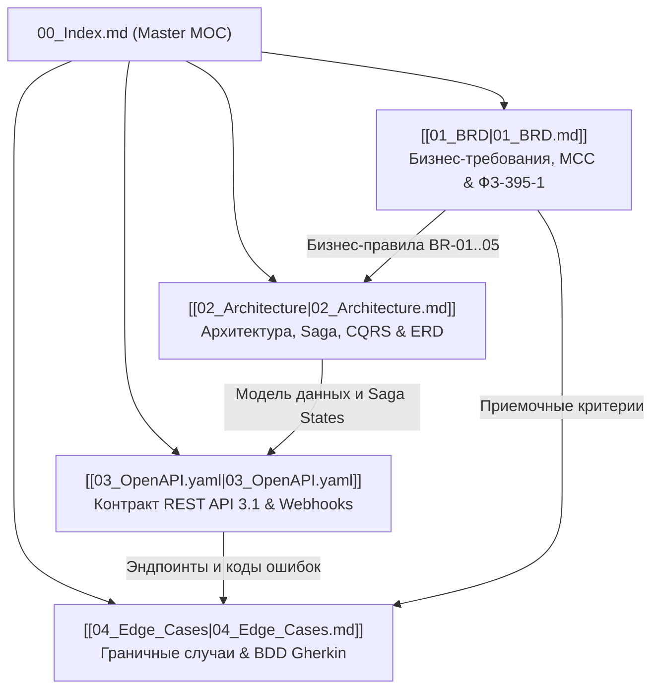

# FinTech × Media Ecosystem (`bank_kinopoisk`): Master Knowledge Index (MOC)

> [!NOTE]
> Данный комплект спецификаций сгенерирован и верифицирован универсальным пайплайном **SA-Spec-Pipeline** по паттерну **Orchestrator-Worker** для бизнес-кейса объединения **Банка** и **Кинопоиска** ([bank_kinopoisk_raw.txt](file:///Users/khantemir/sa-spec-pipeline/inbox/bank_kinopoisk_raw.txt)).

---

## 1. Навигационная карта артефактов (Obsidian Graph)

### Документы комплекта:
1. **[[01_BRD|01_BRD.md — Business Requirements Document]]**
   - Бизнес-цели: рост оборота по картам Банка на **+25%**, снижение оттока подписок Кинопоиска с **12% до ≤ 4%**, рост конверсии TVOD на Smart TV на **+30%**.
   - **Раздел 7 (Contradictions Log):** разрешение 5 фундаментальных конфликтов между бизнесом, ИБ Банка (ст. 26 ФЗ-395-1), антифродом и архитектурой.
2. **[[02_Architecture|02_Architecture.md — System Architecture & Data Model]]**
   - **CQRS Read Projection (`SUBSCRIPTION_STATE`):** полная изоляция АБС Банка от пятничного прайм-тайма Кинопоиска (2 млн зрителей, 0 синхронных вызовов в АБС).
   - **Saga Pattern с защитой от таймаутов (`RECONCILING`):** двухфазное списание `Баллы Банка + Рубли` без риска потери баллов или двойного списания.
   - **Mermaid ERD, Saga State Machine и 2 Sequence-диаграммы.**
3. **[[03_OpenAPI.yaml|03_OpenAPI.yaml — OpenAPI 3.1.0 Contract]]**
   - Эндпоинты: `POST /consents`, `GET /subscriptions/{ecosystem_user_id}`, `PUT /subscriptions/{ecosystem_user_id}`, `POST /hybrid-payments`, `GET /hybrid-payments/{payment_id}`, `POST /hybrid-payments/{payment_id}/compensate` и вебхук `ecosystemDomainEvent`.
4. **[[04_Edge_Cases|04_Edge_Cases.md — Edge Cases & BDD Test Scenarios]]**
   - 8 критических сценариев отказа и 5 приемочных BDD Gherkin-тестов.

---

## 2. Отчет Критика-Оркестратора (Audit Diff: Worker vs Gemini 4 Argon)

В ходе ревью черновиков, созданных воркером (`gemini-3.5-flash-lite` в `drafts/`), Оркестратор (**Gemini 4 Argon**) обнаружил и устранил **5 критических архитектурных дефектов**:

| № | Область аудита | Дефект в черновике воркера (`drafts/`) | Исправление Оркестратора (`final/`) | Почему это критично |
| :-: | :--- | :--- | :--- | :--- |
| **1** | **Опасная ошибка Saga при таймауте `504` (`BR-04`)** | В `04_Edge_Cases.md` (Scenario 5) воркер написал: *«При таймауте 504 от платежного шлюза Банка немедленно перевести сессию в `COMPENSATED` и разморозить баллы (`RELEASE`)»*. | Добавлен промежуточный статус `RECONCILING` и ответ `202 Accepted`. Разморозка баллов при `504` **запрещена** до сверки статуса списания рублей в Банке по `Idempotency-Key`! | Если Банк успел списать 200 ₽ перед обрывом связи, а воркер сразу разморозил 300 баллов, клиент либо потеряет деньги, либо получит и фильм, и баллы обратно! |
| **2** | **Утечка `parent_pin_hash` в ответе API** | В `03_OpenAPI.yaml` воркер включил поле `parent_pin_hash` прямо в JSON-ответ `HybridPaymentSessionResponse`! | `parent_pin_hash` (Argon2id) перенесен в `ECOSYSTEM_USER` (с полями `pin_failed_attempts` и `pin_locked_until`), а в запросе `CreateHybridPaymentRequest` передается только write-only `parent_pin_code`. | Возврат хеша ПИН-кода в API-ответах на Smart TV — грубая уязвимость ИБ (возможность офлайн-перебора 4 цифр за миллисекунды). |
| **3** | **Забытые эндпоинты согласия (`FR-01`) и чтения статуса (`FR-02`)** | В `03_OpenAPI.yaml` воркер создал только `PUT /subscriptions/status`, но забыл `POST /consents` (согласие по ФЗ-395-1) и `GET /subscriptions/{ecosystem_user_id}` (чтение проекции для 2 млн зрителей)! | В `03_OpenAPI.yaml` добавлены `POST /consents` и высокоскоростной `GET /subscriptions/{ecosystem_user_id}`. | Без `GET` эндпоинта Кинопоиск не может отобразить шкалу прогресса 15 000 ₽, а без `POST /consents` нарушается 152-ФЗ и банковская тайна. |
| **4** | **Мусорные схемы из шаблона в `03_OpenAPI.yaml`** | Воркер оставил в `components.schemas` неиспользуемые заглушки `CreateResourceRequest`, `CancelResourceRequest`, `ResourceResponse`. | Все шаблонные заглушки полностью удалены; спецификация чистая и 100% доменная. | Генераторы кода (`oapi-codegen` / `openapi-generator`) создали бы мертвые классы в проекте. |
| **5** | **Защита от абуза возвратов (`CLAWBACK_DEBT`)** | Воркер упомянул возвраты в тексте BRD, но не добавил статус в `SUBSCRIPTION_STATE` и не написал Gherkin-тест. | Добавлен статус `CLAWBACK_DEBT`, поле `is_refund_event` в `PUT /subscriptions/{ecosystem_user_id}` и Gherkin Scenario 5. | Закрывает схему фрода «купил куртку за 15 000 ₽ -> получил бесплатный Кинопоиск -> сдал куртку». |

---

## 3. Матрица сквозной трассируемости (Traceability Matrix)

| Требование BRD | Бизнес-правило | Сущность / Поле ERD (`02_Architecture`) | Эндпоинт / Схема OpenAPI (`03_OpenAPI`) | BDD Сценарий (`04_Edge_Cases`) |
| :--- | :--- | :--- | :--- | :--- |
| **FR-01** (Согласие на связку Банк ↔ Кинопоиск) | — | `USER_CONSENT.status` (`GRANTED` / `REVOKED`) | `POST /consents` (`422 CONSENT_REQUIRED`) | EC-06, Scenario 1 |
| **FR-02** (Витрина статуса для Prime Time) | **BR-01** | `SUBSCRIPTION_STATE.spend_target_met` | `GET /subscriptions/{ecosystem_user_id}` | EC-08 |
| **FR-03** (Фильтр MCC и защита от возвратов) | **BR-01**, **BR-02** | `SUBSCRIPTION_STATE.subscription_status` (`CLAWBACK_DEBT`) | `PUT /subscriptions/{ecosystem_user_id}` | Scenario 5 |
| **FR-04** (Гибридная оплата по паттерну Saga) | **BR-04** | `HYBRID_PAYMENT_SESSION`, `SUB_TRANSACTION` | `POST /hybrid-payments`, `POST /hybrid-payments/{id}/compensate` | Scenario 1, Scenario 2, Scenario 3 |
| **FR-05** (Лимит баллов <= 99%, минимум 1 ₽) | **BR-03** | `HYBRID_PAYMENT_SESSION.paid_points_minor`, `paid_money_minor` | `POST /hybrid-payments` (`422 MAX_POINTS_LIMIT_EXCEEDED`) | EC-03 |
| **FR-06** (Защита Smart TV — Parental PIN) | **BR-05** | `ECOSYSTEM_USER.parent_pin_hash`, `pin_failed_attempts`, `pin_locked_until` | `CreateHybridPaymentRequest.parent_pin_code` (`422 PARENTAL_PIN_LOCKED`) | Scenario 4 |
