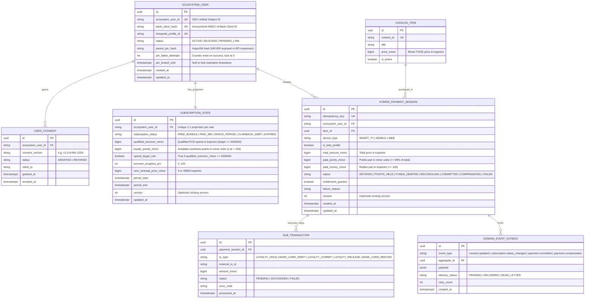
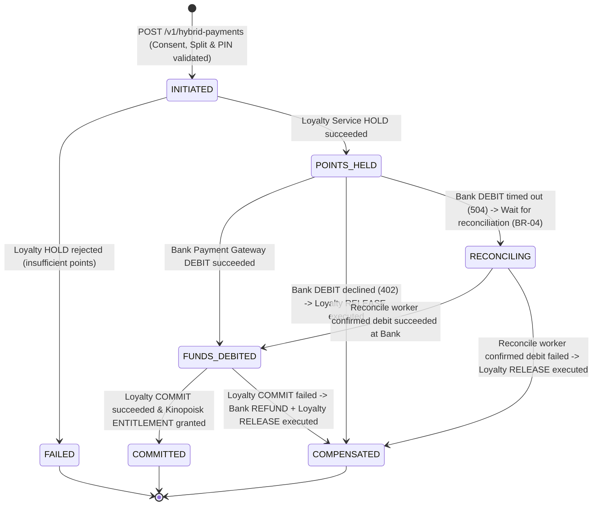
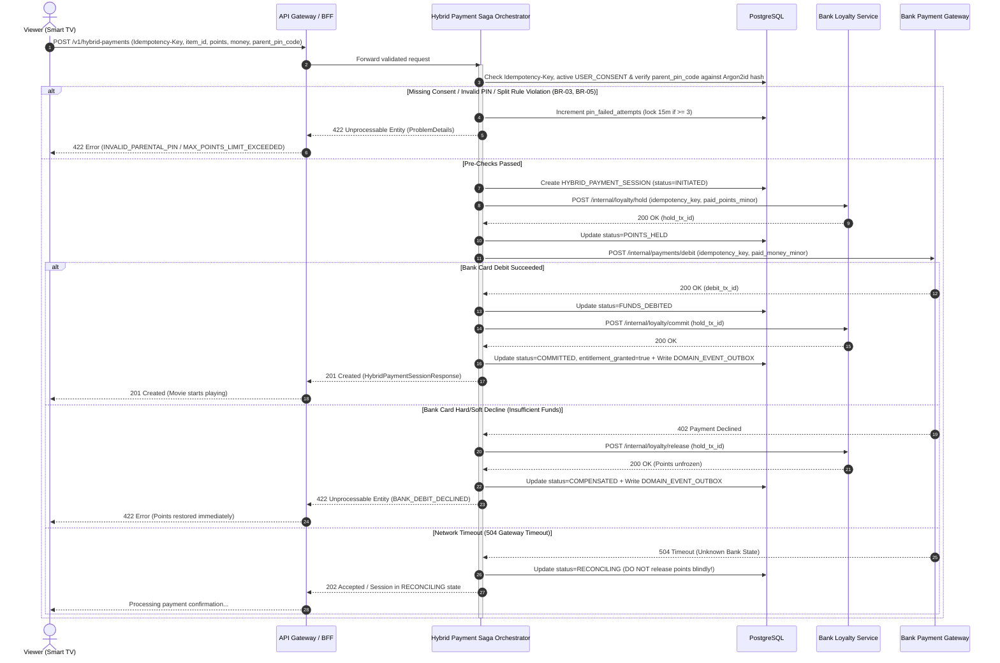
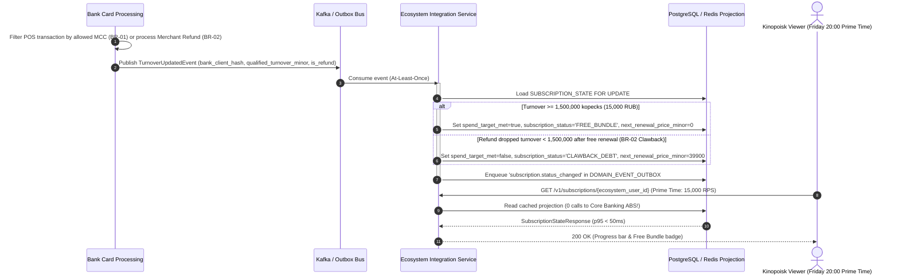

# System Architecture & Data Model: FinTech × Media Ecosystem (`bank_kinopoisk`)

> **Document Status:** Verified (Orchestrator Approved)  
> **Version:** 1.0  
> **Related BRD:** `01_BRD.md`  
> **Related API Contract:** `03_OpenAPI.yaml`  
> **Pipeline Pattern:** Orchestrator-Worker (Worker: `gemini-3.5-flash-lite`, Critic: `Gemini 4 Argon`)

---

## 1. Architectural Overview & Design Principles
### 1.1 Architectural Style & Patterns
Архитектура интеграции **Банка** и **Кинопоиска** построена вокруг изолированного промежуточного шлюза **Ecosystem Media-Banking Integration Service** с использованием паттернов **CQRS Read Projection**, **Orchestrated Saga** и **Transactional Outbox**:

1. **Изоляция банковской тайны (Zero Raw Banking Data in Media):** АБС Банка никогда не передает в контур Кинопоиска номера счетов, PAN карт, остатки денежных средств или выписку по операциям (ст. 26 ФЗ-395-1). В шлюз передаются только агрегированные проекции (`spend_target_met`, `qualified_turnover_minor`, `loyalty_points_minor`) и только при наличии активного согласия `USER_CONSENT`.
2. **Защита АБС в пятничный Prime Time (CQRS Local Projection):** Когда 2 миллиона зрителей открывают Кинопоиск в пятницу в 20:00, запросы `GET /v1/subscriptions/{ecosystem_user_id}` обслуживаются за `< 50–150 мс` из локальной проекции `SUBSCRIPTION_STATE` в БД/Redis шлюза, не создавая ни одного синхронного запроса в Core Banking.
3. **Двухфазная гибридная оплата (Saga Orchestrator с защитой от таймаутов):** Покупка фильма (TVOD) за баллы + рубли проходит через состояния `INITIATED -> POINTS_HELD -> FUNDS_DEBITED -> COMMITTED`. При явном отказе списания рублей выполняется компенсация `COMPENSATED` (`LOYALTY_RELEASE`). При сетевом таймауте (`504`) сессия переводится в `RECONCILING` до сверки фактического статуса списания денег в Банке (`BR-04`).
4. **Безопасность Smart TV (Argon2id Parental PIN + Rate Lockout):** Хеш родительского ПИН-кода хранится только во внутренней таблице `ECOSYSTEM_USER` (никогда не возвращается в API ответах!) и защищен счетчиком `pin_failed_attempts` с блокировкой на 15 минут после 3 ошибок (`BR-05`).

### 1.2 System Components & Responsibilities
| Component | Layer / Technology | Core Responsibility |
| :--- | :--- | :--- |
| **API Gateway / Edge BFF** | Envoy / Kong | Проверка SSO JWT-токенов, TLS 1.3, rate-limiting, валидация заголовка `Idempotency-Key`. |
| **Ecosystem Integration Service** | Go / Java Spring Boot | Управление согласиями (`USER_CONSENT`), отдача локальной проекции статуса бандла (`SUBSCRIPTION_STATE`), проверка Parental PIN. |
| **Hybrid Payment Saga Orchestrator** | Application Layer | Координация распределенной транзакции между Сервисом Лояльности Банка (`HOLD`/`COMMIT`/`RELEASE`), Платежным шлюзом (`DEBIT`) и выдачей прав Кинопоиска (`ENTITLEMENT`). |
| **Reconciliation & Outbox Worker** | Background Worker / Kafka | Асинхронная доставка событий из `DOMAIN_EVENT_OUTBOX` и сверка зависших в `RECONCILING` платежных сессий. |
| **PostgreSQL 16 + Redis Cluster** | Storage Layer | ACID-хранение сущностей, оптимистическая блокировка (`version`), быстрый кэш статусов для пятничного прайм-тайма. |

---

## 2. Entity-Relationship Diagram (ERD)
> [!IMPORTANT]
> Все сущности, названия полей, типы данных и перечисления статусов (`enum`) на 100% синхронизированы со схемами в `03_OpenAPI.yaml`. Секретные поля (`parent_pin_hash`) изолированы в БД и никогда не сериализуются в ответы API.

---

## 3. Core Aggregate Lifecycle (Saga State Machine)

---

## 4. Core Sequence Diagrams
### 4.1 Гибридная покупка фильма на Smart TV (Parental PIN + Saga + Timeout Protection)

### 4.2 Асинхронный расчет оборота 15 000 ₽, защита от возвратов (`Clawback`) и Prime-Time чтение

---

## 5. Architectural & Data Consistency Decisions
| Decision Area | Chosen Approach | Rationale |
| :--- | :--- | :--- |
| **Monetary & Points Precision** | `BIGINT` (`int64`) в минорных единицах (`1 ₽ = 100 копеек`, `1 балл = 100 минорных единиц`). | Полное исключение ошибок округления `float` при расчете пропорции `99% / 1%` (`BR-03`). |
| **Banking Secrecy (ФЗ-395-1)** | Хранение только `bank_client_hash` и агрегированного `qualified_turnover_minor` после подписания `USER_CONSENT`. | Медиа-контур физически не имеет доступа к банковской тайне, номерам счетов и списку покупок клиента. |
| **Saga Timeout Safety (`BR-04`)** | Промежуточный статус `RECONCILING` при таймауте `504` от платежного шлюза Банка. | Предотвращает убыток, когда деньги с карты списались с задержкой, а система уже разморозила баллы лояльности. |
| **Parental PIN Security (`BR-05`)** | Хеширование Argon2id в `ECOSYSTEM_USER.parent_pin_hash`, поле **исключено** из всех DTO ответов API. | Исключает утечку хеша родительского ПИН-кода через клиентские логи Smart TV. |
| **Prime-Time Isolation** | Локальная CQRS-проекция `SUBSCRIPTION_STATE` в PostgreSQL + Redis. | Защищает АБС Банка от падения во время вечерних премьер на Кинопоиске (2 млн зрителей). |
