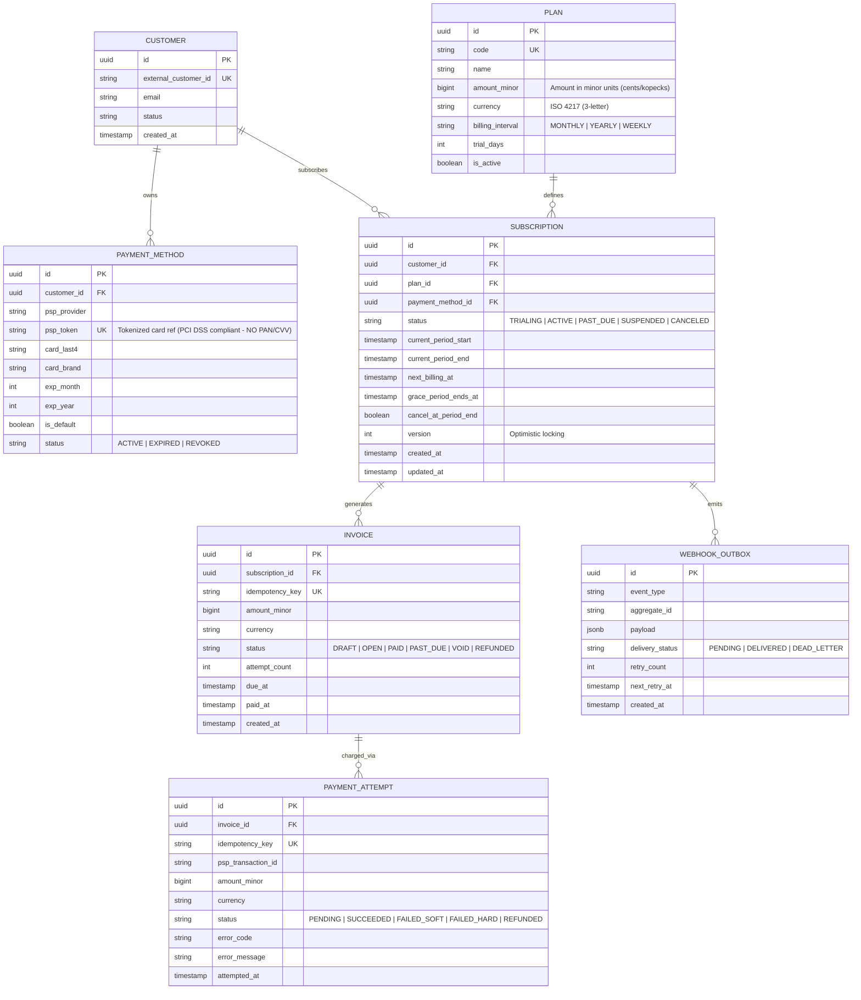
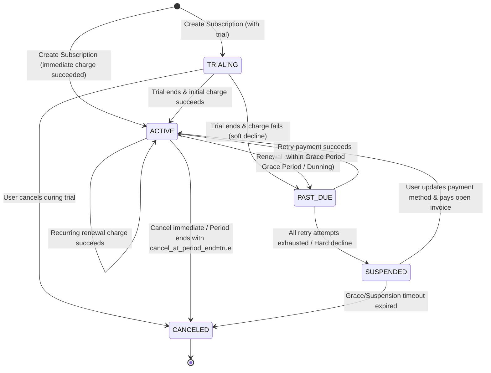
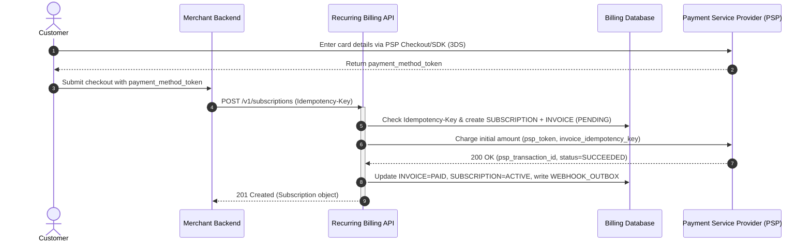
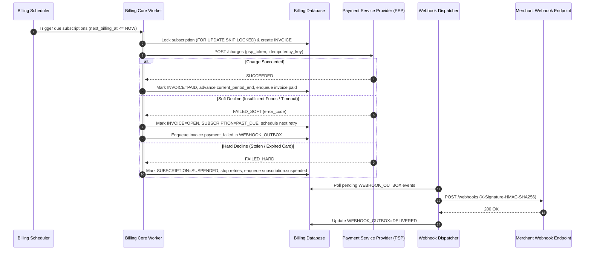

# System Architecture & Data Model: payment_gateway

> **Document Status:** Draft / Verified  
> **Version:** 1.0  
> **Related BRD:** `01_BRD.md`  
> **Related API Contract:** `03_OpenAPI.yaml`

---

## 1. Architectural Overview & Design Principles
### 1.1 Architectural Style & Patterns
Сервис построен на базе микросервисной архитектуры (Event-Driven Microservices / Billing Core), реализующей строгую изоляцию платежной логики от основного монолита (Merchant Backend). 

Основные архитектурные паттерны:
- **Transactional Outbox:** Гарантированная доставка событий (вебхуков) во внешние системы без потери данных при сбоях сети или падении сервиса. Запись бизнес-сущности и события вебхука происходят в рамках одной атомарной транзакции базы данных.
- **Idempotency-Key Handling:** Все изменяющие запросы (POST) требуют заголовок `Idempotency-Key` (UUID). Запросы идемпотентно кэшируются на уровне БД для предотвращения двойных списаний и дублирования операций при нестабильной связи.
- **Finite State Machine (FSM):** Управление жизненным циклом подписок (`SUBSCRIPTION`), инвойсов (`INVOICE`) и платежных попыток (`PAYMENT_ATTEMPT`) через строгие модели состояний, исключающие некорректные переходы.
- **Circuit Breaker & Retry with Exponential Backoff / Dunning:** Управление сетевыми вызовами к эквайреру (PSP) с жестким таймаутом (10 сек) и защитой от «слепых» повторных списаний при тайм-аутах через предварительную проверку статуса транзакции.

### 1.2 System Components & Responsibilities
| Component | Technology / Layer | Core Responsibility |
| :--- | :--- | :--- |
| **API Gateway / BFF** | Go / Fiber or Chi, REST API | Маршрутизация запросов, валидация заголовков идемпотентности, проверка HMAC-подписей, rate limiting. |
| **Subscription & Billing Core** | Go, Domain Service | Управление подписками, расчет дат (`BR-01`), логика Grace Period и Dunning, обработка возвратов (`BR-03`). |
| **Payment Orchestrator / PSP Adapter** | Go, Integration Layer | Интеграция с эквайером (PSP), токенизация (`psp_token`), инициация MIT-платежей, обработка таймаутов (`BR-05`). |
| **Scheduler / Retry Worker** | Go, Cron / Temporal / Redis | Фоновые задачи по проверке наступления сроков списаний (`next_billing_at`), выполнению сетки ретраев (`BR-02`). |
| **Notification / Webhook Dispatcher** | Go, Outbox Worker | Чтение таблицы `WEBHOOK_OUTBOX`, подписание событий `HMAC-SHA256`, доставка в Merchant Backend с повторами. |

---

## 2. Entity-Relationship Diagram (ERD)
> [!IMPORTANT]
> All entity attributes, types, and primary/foreign keys MUST strictly match the schemas in `03_OpenAPI.yaml`.

---

## 3. Subscription Lifecycle State Machine

---

## 4. Core Sequence Diagrams
### 4.1 Initial Subscription Creation & Tokenization Flow

### 4.2 Scheduled Recurring Charge, Retry (Dunning) & Webhook Flow

---

## 5. Integration & Data Consistency Decisions
| Decision Area | Chosen Approach | Rationale |
| :--- | :--- | :--- |
| **Monetary Representation** | Integer minor units (`amount_minor`, `int64`) + ISO 4217 `currency` | Предотвращает ошибки округления чисел с плавающей точкой (IEEE 754), критично для расчетов копеек и возвратов (`BR-04`). |
| **PCI DSS Scope Reduction** | Токенизация через PSP (`psp_token`), хранение только `card_last4`, `card_brand`, `exp_month/year` | Снижает уровень комплайенса до SAQ A, исключая хранение PAN и CVV на стороне сервиса (OQ-02). |
| **Double-Charge Prevention** | Заголовок `Idempotency-Key` от клиента + уникальный индекс в БД по инвойсам/транзакциям | Гарантирует выполнение операции ровно один раз (exactly-once) даже при повторных сетевых вызовах. |
| **Event Delivery** | Паттерн Transactional Outbox (`WEBHOOK_OUTBOX`) + подпись `HMAC-SHA256` | Исключает потерю вебхуков при падении сервиса или сбоях сети, обеспечивая асинхронную интеграцию с Merchant Backend (OQ-05). |
