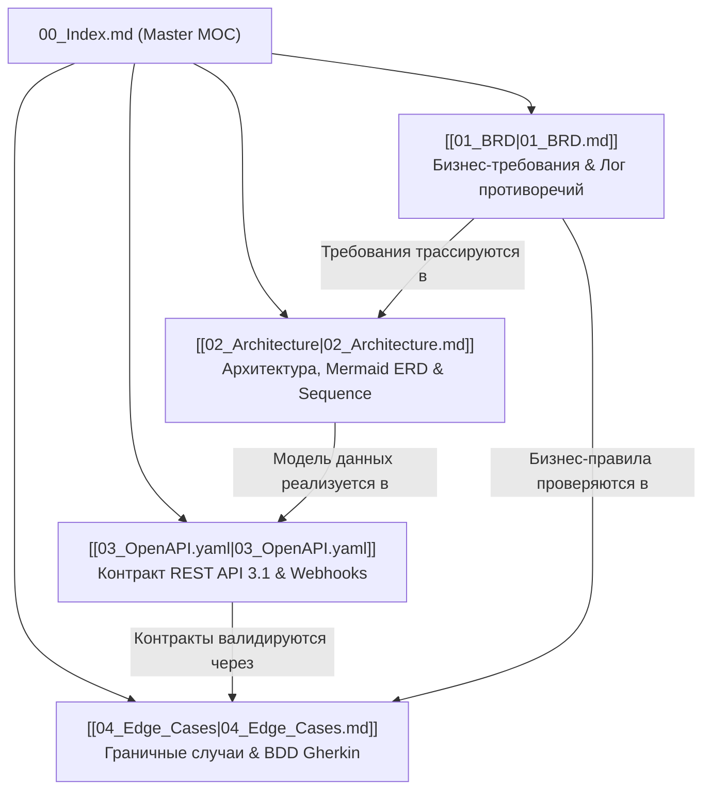

# Payment Gateway Core: Master Knowledge Index (MOC)

> [!NOTE]
> Данный пакет спецификаций сформирован и верифицирован в рамках пайплайна **SA-Spec-Pipeline** с использованием паттерна **Orchestrator-Worker**.  
> Документация готова для импорта в базу знаний **Obsidian**, интеграции в CI/CD и передачи кросс-функциональной команде разработки (Backend, Frontend, QA, DevOps).

---

## 1. Навигационная карта артефактов (Obsidian Graph)

### Документы комплекта:
1. **[[01_BRD|01_BRD.md — Business Requirements Document]]**
   - Бизнес-цели (снижение комиссии эквайринга, сокращение involuntary churn с 18% до ≤ 8%, запуск MVP за 6 недель).
   - Границы MVP (только RUB и MONTHLY) vs Фаза 2 (KZT, USD, годовые тарифы, промо-триалы).
   - **Раздел 7: Contradictions, Ambiguities & Open Questions Log** (детальный разбор 7 коллизий из сырых заметок).
2. **[[02_Architecture|02_Architecture.md — System Architecture & Data Model]]**
   - Архитектурные паттерны: **Transactional Outbox**, **Idempotency-Key**, **FSM**, пессимистические блокировки (`FOR UPDATE`).
   - Полная **Mermaid ERD** диаграмма со строгими типами `bigint amount_minor` и токенизацией `psp_token` (PCI DSS SAQ A).
   - Конечный автомат подписки (**stateDiagram-v2**) и две Sequence-диаграммы (первичная привязка и регулярный dunning).
3. **[[03_OpenAPI.yaml|03_OpenAPI.yaml — OpenAPI 3.1.0 Contract]]**
   - Строгая схема REST API (создание, отмена, возврат, просмотр подписки).
   - RFC 9457 `ProblemDetails` для ошибок `400`, `402`, `404`, `409`, `422`.
   - Описание исходящих событий (`webhooks`) с подписью `X-Webhook-Signature` (`HMAC-SHA256`).
4. **[[04_Edge_Cases|04_Edge_Cases.md — Edge Cases & BDD Test Scenarios]]**
   - 8 критических архитектурных сценариев отказа.
   - 6 подробных BDD приемочных сценариев на языке **Gherkin** (идемпотентность, Soft vs Hard decline, календарь 31 янв -> 28 фев -> 31 мар, лимиты частичных возвратов, таймауты PSP 10с).

---

## 2. Отчет Критика-Оркестратора (Audit Diff & Resolution Log)

В процессе ревью черновиков, сгенерированных воркером (`gemini-3.5-flash-lite`), Оркестратор (**Gemini 4 Argon**) выявил и устранил следующие расхождения и дефекты:

| № | Область | Что было в сырых заметках / черновике воркера | Как исправлено в финальной спецификации (Orchestrator) | Архитектурная причина |
| :-: | :--- | :--- | :--- | :--- |
| **1** | **Денежный тип** | В заметках Тимур предложил `float: 299.90`. В черновике воркера встречался риск смешения типов. | Строго зафиксирован `amount_minor: bigint / int64` во всех схемах OpenAPI, ERD и Gherkin. | Исключение ошибок округления IEEE 754 при частичных возвратах и расчете комиссий. |
| **2** | **Хранение карт** | В заметках Игорь просил хранить PAN и CVV в БД. | Категорический отказ. В ERD сохраняется только `psp_token`, маска `card_last4`, бренд и даты действия. | Обеспечение соответствия PCI DSS SAQ A, исключение риска многомиллионных штрафов. |
| **3** | **Сетка Dunning & Grace** | Воркер в разных файлах указал 5 дней Grace Period, а в заметках Марина требовала 7 дней, Руслан — 3 дня. | Единый согласованный стандарт: **Grace Period = 7 дней**, сетка ретраев: **День +1, День +3, День +7**. | Защита от спама эквайера, синхронизация с зарплатным циклом абонентов в РФ. |
| **4** | **Hard vs Soft Decline** | В черновике воркера логика Hard Decline не везде прерывала цикл ретраев. | Добавлено строгое разделение: при `card_stolen` / `card_expired` статус мгновенно становится `SUSPENDED` без повторов. | Предотвращение штрафов и блокировок мерчанта со стороны платежных систем (НСПК/МИР). |
| **5** | **Интеграция с монолитом** | В заметках предлагался минутный поллинг всей БД. | Поллинг исключен. Внедрен паттерн **Transactional Outbox** с гарантией `at-least-once` и подписью `HMAC-SHA256`. | Защита базы данных от лавинообразной нагрузки (N+1 queries). |
| **6** | **Календарь конца месяца** | Спор участников о 31 января и 28 февраля; в ERD не было поля для хранения исходного дня месяца после сдвига на 28 февраля. | Формализовано правило `BR-01`: в `SUBSCRIPTION` (ERD и `SubscriptionResponse`) добавлено поле `anchor_day` (`1..31`) для возврата к 31 марта после 28 февраля. Описан Gherkin-тест. | Без хранения `anchor_day` система после 28 февраля навсегда сдвинула бы биллинг на 28-е число. |
| **7** | **Контроль возвратов** | Баг Марины: двойной возврат 600 руб при чеке 1000 руб (возврат 1200 руб); отсутствие статуса частичного возврата. | В `INVOICE` добавлены поле `amount_refunded_minor` и статус `PARTIALLY_REFUNDED` (в ERD и `InvoiceStatus`). В OpenAPI и `BR-04` включена валидация остатка (HTTP 422). | Защита бизнеса от двойных частичных возвратов и однозначность статуса частично возвращенного чека. |

---

## 3. Матрица трассируемости требований (Traceability Matrix)

| Требование BRD | Бизнес-правило | Сущность ERD (`02_Architecture`) | Эндпоинт OpenAPI 3.1 (`03_OpenAPI`) | Сценарий BDD (`04_Edge_Cases`) |
| :--- | :--- | :--- | :--- | :--- |
| **FR-01** (Жизненный цикл подписки) | — | `SUBSCRIPTION` | `POST /subscriptions`, `GET /subscriptions/{id}`, `POST /subscriptions/{id}/cancel` | Scenario 1, Scenario 2 |
| **FR-02** (Якорные даты списания) | **BR-01** | `SUBSCRIPTION.next_billing_at` | `SubscriptionResponse.next_billing_at` | Scenario 4 |
| **FR-03** (Soft Decline & Dunning) | **BR-02** | `INVOICE`, `PAYMENT_ATTEMPT` | `Webhook: invoice.payment_failed` | Scenario 2 |
| **FR-04** (Hard Decline & отмена) | **BR-03** | `SUBSCRIPTION.status` (`SUSPENDED`) | `Webhook: subscription.suspended` | Scenario 3 |
| **FR-05** (PCI DSS Токенизация) | — | `PAYMENT_METHOD.psp_token` | `CreateSubscriptionRequest.payment_method_id` | Scenario 1 |
| **FR-06** (Возвраты инвойсов) | **BR-04** | `INVOICE.amount_refunded_minor` | `POST /invoices/{id}/refund` | Scenario 5 |
| **FR-07** (Идемпотентность API) | — | `INVOICE.idempotency_key` | `Header: Idempotency-Key` (UUID v4) | Scenario 1 |
| **FR-08** (Transactional Outbox) | — | `WEBHOOK_OUTBOX` | `webhooks.subscriptionLifecycleEvent` | Scenario 2, Scenario 3 |
| — (Защита от таймаутов PSP) | **BR-05** | `PAYMENT_ATTEMPT.status` (`PENDING`) | `ProblemDetails (504)` | Scenario 6 |

---

## 4. Рекомендации по передаче в разработку
1. **Бэкенд-разработка:**
   - Развернуть базу данных PostgreSQL 16+ на основе DDL из `02_Architecture.md`.
   - Сгенерировать серверные DTO и валидаторы напрямую из контракта `03_OpenAPI.yaml` (через `oapi-codegen` для Go или `openapi-python-client`).
2. **QA-инженерия:**
   - Импортировать Gherkin-сценарии из `04_Edge_Cases.md` в автотесты (PyTest-BDD / Cucumber / Godog).
3. **Безопасность (SecOps):**
   - Убедиться, что фронтенд использует JS SDK банка для токенизации, а бэкенд не логирует заголовки авторизации и платежные токены в открытом виде.
