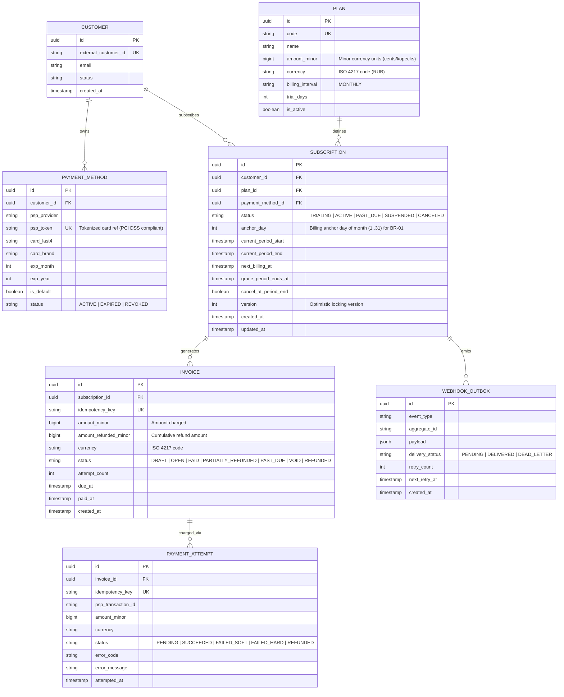
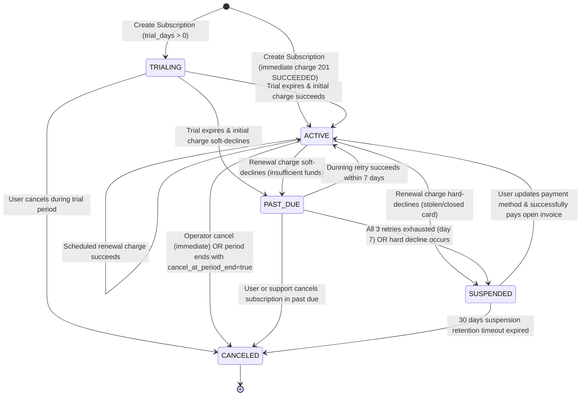
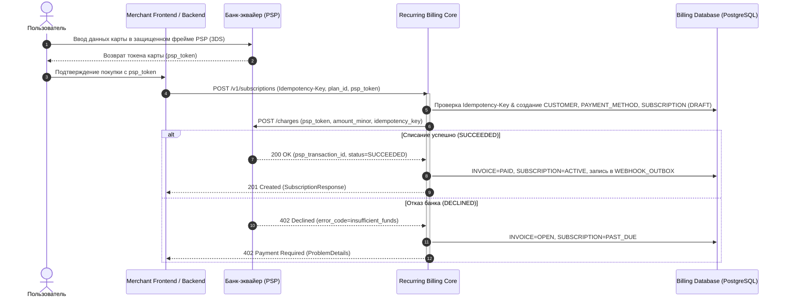
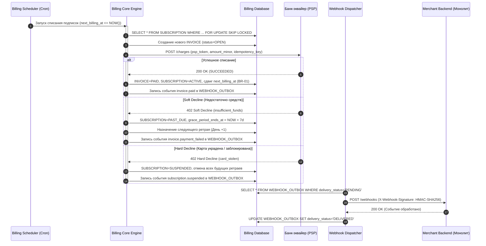

# System Architecture & Data Model: Payment Gateway Core

> **Document Status:** Verified (Orchestrator Approved)  
> **Version:** 1.0  
> **Related BRD:** `01_BRD.md`  
> **Related API Contract:** `03_OpenAPI.yaml`  
> **Pipeline Pattern:** Orchestrator-Worker (Critic: `Gemini 4 Argon`)

---

## 1. Architectural Overview & Design Principles

### 1.1 Architectural Decisions & Patterns
- **Transactional Outbox Pattern:** Гарантированная доставка событий изменения статусов подписок и инвойсов в Merchant Backend. Событие сохраняется в таблицу `WEBHOOK_OUTBOX` в той же ACID-транзакции БД, что и изменение состояния подписки.
- **Idempotency Engine:** Все мутирующие HTTP-запросы (`POST`) обязаны содержать заголовок `Idempotency-Key` (UUID v4). Результат выполнения кэшируется в БД на 24 часа. Повторный запрос с тем же ключом не приводит к повторному списанию у PSP.
- **Strict Monetary Representation:** Категорический отказ от `float`/`double`. Все денежные значения хранятся как целые числа в минимальных единицах (`amount_minor: bigint / int64`, копейки/центы), валюта задается кодом ISO 4217 (`currency: string`).
- **PCI DSS Scope Minimization (SAQ A):** Сервис не видит и не хранит PAN и CVV. Платежная форма хостится на стороне PSP, бэкенд оперирует исключительно `psp_token` и маскированными реквизитами (`card_last4`, `card_brand`).
- **Pessimistic Concurrency Control:** Все операции изменения подписки (автопродление кроном, ручная отмена, возврат) выполняются с пессимистической блокировкой строки `SELECT ... FOR UPDATE`, исключая состояние гонки (*race condition*).

### 1.2 System Components & Responsibilities
| Component | Layer / Tech Stack | Core Responsibility |
| :--- | :--- | :--- |
| **API Gateway / Ingress** | Nginx / Envoy / Go Ingress | Маршрутизация, TLS-терминация, проверка заголовков `Idempotency-Key`, rate-limiting. |
| **Billing Core Engine** | Go / Python Async Service | Доменная логика подписок, календарная арифметика дат (`BR-01`), управление возвратами (`BR-04`). |
| **Dunning & Billing Scheduler** | Distributed Cron Worker | Периодический выбор подписок к продлению (`next_billing_at <= NOW()`), исполнение сетки dunning-ретраев. |
| **PSP Integration Adapter** | HTTP Client with Circuit Breaker | Взаимодействие с банком-эквайером, токенизация, MIT-списания, сверка зависших платежей при таймауте 10с. |
| **Webhook Dispatcher** | Outbox Background Worker | Поллинг таблицы `WEBHOOK_OUTBOX`, подписание полезной нагрузки `HMAC-SHA256`, доставка в монолит с backoff-повторами. |
| **Primary Relational Database** | PostgreSQL 16+ | Реляционное хранилище со строгой ссылочной целостностью, внешними ключами и уникальными индексами. |

---

## 2. Entity-Relationship Diagram (ERD)
> [!IMPORTANT]
> Все сущности, названия атрибутов, типы данных и статусы строго согласованы со схемами контракта `03_OpenAPI.yaml`.

---

## 3. Subscription Lifecycle State Machine

---

## 4. Sequence Diagrams

### 4.1 Первичное оформление подписки и безопасная токенизация (PCI DSS SAQ A)

### 4.2 Рекуррентное списание по расписанию, Dunning (Soft vs Hard Decline) и Outbox

---

## 5. Архитектурные гарантии надежности и комплаенса
1. **Точность денег:** Все финансовые подсчеты и валидации выполняются исключительно в `int64` (копейки). Исключены любые риски погрешностей типа IEEE 754.
2. **Изоляция сбоев PSP:** Таймаут вызова эквайера — жестко 10 000 мс. При обрыве соединения статус платежной попытки переводится в `PENDING`, а специальный reconcile-воркер опрашивает PSP по сохраненному `Idempotency-Key` до совершения любых дальнейших действий.
3. **Защита от повторных частичных возвратов:** Инвариант `BR-04` проверяется внутри транзакции: `amount_refunded_minor + new_refund_minor <= amount_minor`. Превышение исходного платежа технически заблокировано.
