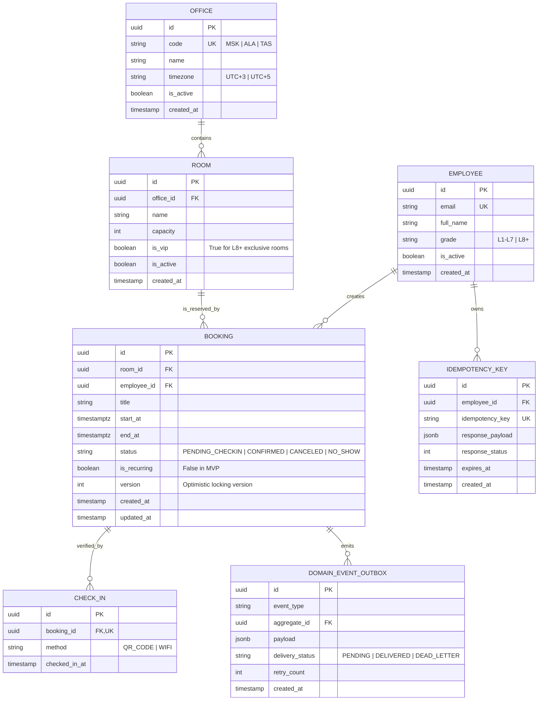
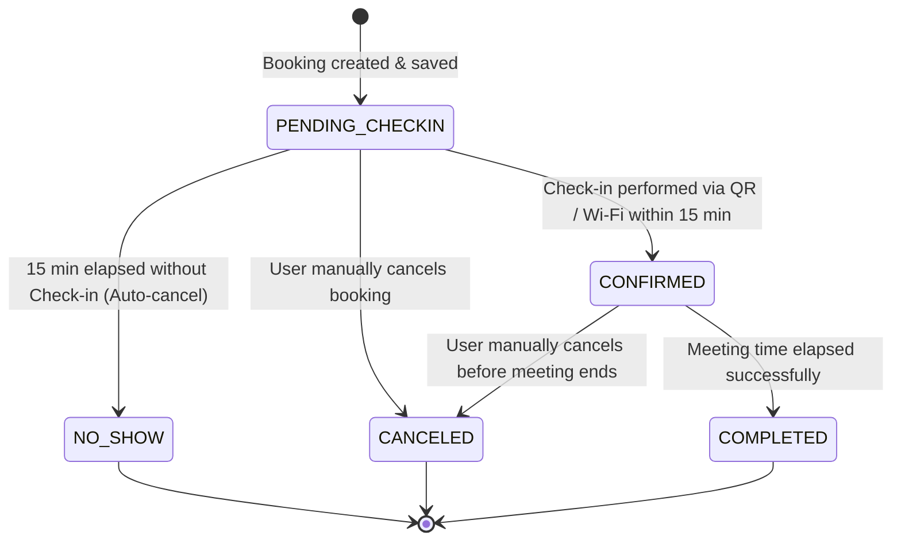
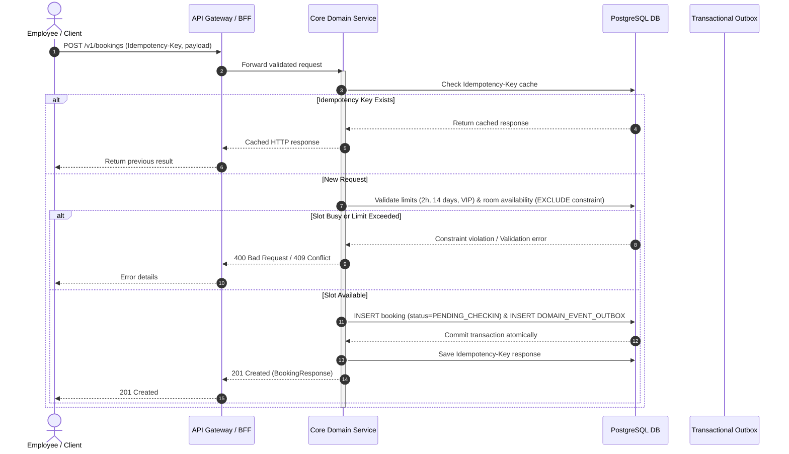
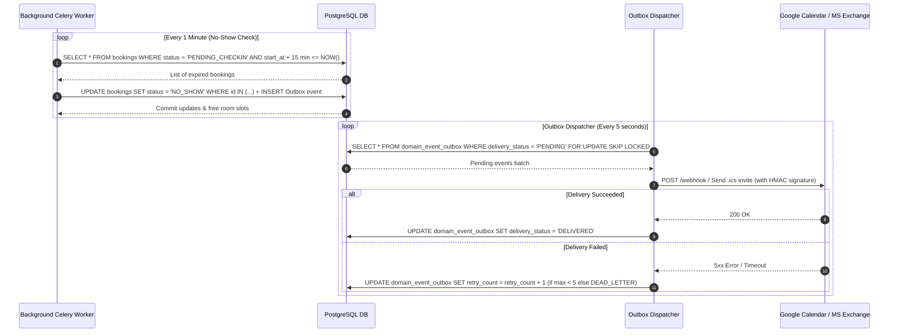

# System Architecture & Data Model: room_booking

> **Document Status:** Draft / Verified  
> **Version:** 1.0  
> **Related BRD:** `01_BRD.md`  
> **Related API Contract:** `03_OpenAPI.yaml`

---

## 1. Architectural Overview & Design Principles
### 1.1 Architectural Style & Patterns
Сервис `room_booking` построен на основе модульной монолитной архитектуры (Modular Monolith) с выделением асинхронных фоновых воркеров для интеграции со сторонними сервисами (Google Calendar / MS Exchange). 

Ключевые паттерны надежности и целостности данных:
- **Transactional Outbox:** Гарантированная доставка асинхронных доменных событий (создание, отмена, перевод в статус `NO_SHOW`) во внешние календари без риска потери данных при сетевых сбоях.
- **Idempotency-Key:** Защита от дублирования запросов на создание бронирования при повторной отправке сетевых пакетов клиентом (реализована через уникальный заголовок и таблицу идемпотентности).
- **Database-Level Exclusion Constraints (Optimistic/Pessimistic Concurrency Control):** Жесткое предотвращение конфликтов типа Double Booking на уровне СУБД PostgreSQL с помощью механизма GIST-индексов для пересечения временных интервалов (`EXCLUDE USING gist`).
- **State Machine (Конечный автомат):** Строгая валидация переходов жизненного цикла бронирования (`PENDING_CHECKIN`, `CONFIRMED`, `CANCELED`, `NO_SHOW`).
- **Timezone Awareness:** Хранение всех временных меток в каноническом формате `TIMESTAMP WITH TIME ZONE` (UTC) в БД с привязкой к идентификатору офиса (`office_id`) для корректного расчёта локального времени в Москве, Алматы и Ташкенте.

### 1.2 System Components & Responsibilities
| Component | Layer / Technology | Core Responsibility |
| :--- | :--- | :--- |
| **API Gateway / BFF** | API Layer / Nginx / FastAPI | Маршрутизация запросов, валидация JWT-токенов корпоративного SSO, rate-limiting, проверка заголовков `Idempotency-Key`. |
| **Core Domain Service** | Application Layer / Python 3.11+ / FastAPI | Ядро бизнес-логики, проверка лимитов (BR-01, BR-02, BR-03), управление состояниями бронирований, валидация VIP-доступа (L8+). |
| **Integration Adapter / Worker** | Infrastructure Layer / Celery / Asyncio Worker | Фоновая отправка `.ics` инвайтов и вебхуков во внешние календари, мониторинг тайм-аутов Check-in (`NO_SHOW`). |
| **Primary Database** | Storage Layer / PostgreSQL 15+ | Хранение доменных сущностей, обеспечение ACID-транзакций, предотвращение Double Booking через `EXCLUDE` constraints. |
| **Event Bus / Outbox Dispatcher** | Messaging Layer / Transactional Outbox Worker | Публикация событий из таблицы `domain_event_outbox` во внешние системы с гарантией доставки (At-Least-Once). |

---

## 2. Entity-Relationship Diagram (ERD)
> [!IMPORTANT]
> Все сущности, названия полей, типы данных, первичные (`PK`), внешние (`FK`) и уникальные (`UK`) ключи строго согласованы со спецификой домена бронирования переговорных комнат.

---

## 3. Core Aggregate Lifecycle (State Machine)

---

## 4. Core Sequence Diagrams
### 4.1 Primary Happy Path & External Integration Flow

### 4.2 Background Processing, Retry / Compensation & Event Delivery Flow

---

## 5. Architectural & Data Consistency Decisions
| Decision Area | Chosen Approach | Rationale |
| :--- | :--- | :--- |
| **Data Types & Precision** | `TIMESTAMP WITH TIME ZONE` (UTC) для всех дат, `UUID v4` для первичных ключей. | Исключает ошибки рассинхронизации таймзон между офисами в Москве, Алматы и Ташкенте. Уникальные идентификаторы безопасны для распределенных систем. |
| **Concurrency & Race Conditions** | PostgreSQL `EXCLUDE USING gist` constraint с оператором перекрытия интервалов (`&&`). | Гарантирует на уровне БД физическую невозможность Double Booking даже при абсолютно одновременных запросах на один и тот же слот. |
| **Idempotency & Retries** | Заголовок `Idempotency-Key` + таблица `idempotency_keys` с фиксацией ответов и TTL 24 часа. | Защищает от повторного создания бронирований при нестабильном сетевом соединении клиента или повторных кликах. |
| **Security & PII Protection** | JWT авторизация через корпоративный OIDC/SSO, передача данных исключительно по HTTPS (TLS 1.3), маскирование персональных данных. | Соответствие стандартам ИБ компании, предотвращение несанкционированного доступа к системе бронирования. |
| **Asynchronous Reliability** | Transactional Outbox паттерн с фоновым воркером и полингом `FOR UPDATE SKIP LOCKED`. | Обеспечивает надежную доставку событий во внешние календари (Google/Exchange) без риска потери данных при падении сервиса. |
