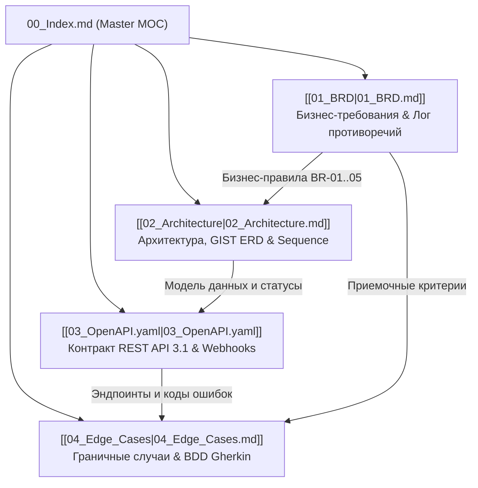

# Smart Room Booking: Master Knowledge Index (MOC)

> [!NOTE]
> Данный комплект спецификаций сгенерирован и верифицирован универсальным пайплайном **SA-Spec-Pipeline** по паттерну **Orchestrator-Worker** на основе сырых заметок со встречи [room_booking_raw.txt](file:///Users/khantemir/sa-spec-pipeline/inbox/room_booking_raw.txt).

---

## 1. Навигационная карта артефактов (Obsidian Graph)

### Документы комплекта:
1. **[[01_BRD|01_BRD.md — Business Requirements Document]]**
   - Бизнес-цели: снижение доли «призрачных броней» (*ghost bookings*) с 40% до ≤ 10%, 0 инцидентов *Double Booking*, запуск MVP в 3 странах за 5 недель.
   - **Раздел 7 (Contradictions Log):** разрешение 5 острых конфликтов между HR, ИБ, VIP-ассистентом совета директоров и разработкой.
2. **[[02_Architecture|02_Architecture.md — System Architecture & Data Model]]**
   - **Mermaid ERD** с поддержкой мульти-таймзон IANA (`Europe/Moscow`, `Asia/Almaty`, `Asia/Tashkent`), динамического TOTP QR и офисного Wi-Fi CIDR.
   - SQL-инвариант `EXCLUDE USING gist (room_id WITH =, tstzrange(start_at, end_at, '[)') WITH &&)` против гонок при бронировании.
   - Конечный автомат (`stateDiagram-v2`) и Sequence-диаграммы создания брони, Check-in, автоотмены `NO_SHOW` и синхронизации календарей через **Transactional Outbox**.
3. **[[03_OpenAPI.yaml|03_OpenAPI.yaml — OpenAPI 3.1.0 Contract]]**
   - Контракты `POST /bookings`, `GET /bookings/{booking_id}`, `POST /bookings/{booking_id}/cancel`, `POST /check-ins` и вебхук `bookingLifecycleEvent`.
   - Полная типизация ошибок через RFC 9457 `ProblemDetails` и типизированный `error_code` enum.
4. **[[04_Edge_Cases|04_Edge_Cases.md — Edge Cases & BDD Test Scenarios]]**
   - 8 архитектурных граничных кейсов и 5 приемочных BDD Gherkin-сценариев.

---

## 2. Отчет Критика-Оркестратора (Audit Diff: Worker vs Gemini 4 Argon)

В ходе проверки черновиков, созданных воркером (`gemini-3.5-flash-lite`), Оркестратор (**Gemini 4 Argon**) выявил и исправил следующие архитектурные уязвимости:

| № | Область аудита | Дефект в черновике воркера (`drafts/`) | Исправление Оркестратора (`final/`) | Почему это критично |
| :-: | :--- | :--- | :--- | :--- |
| **1** | **Защита от фейкового Check-in (`OQ-02`)** | В `03_OpenAPI.yaml` схема `CreateCheckInRequest` принимала только `method: QR_CODE` без самого токена `qr_token`! Любой сотрудник мог отправить `{"method": "QR_CODE"}` из дома. | В `ROOM` добавлен `qr_secret_hash`, а в `CHECK_IN` и `CreateCheckInRequest` — поле `qr_token` (30-секундный TOTP) и проверка `verified_ip` по `OFFICE.wifi_cidr`. | Без проверки `qr_token` или офисной подсети полностью нарушалось требование директора по ИБ (Сергея). |
| **2** | **Права VIP-ассистентов (`OQ-01`)** | В ERD воркера у `EMPLOYEE` было только поле `grade` (`L1-L7 | L8+`). Ассистент совета директоров (Денис, грейд < L8) не смог бы забронировать VIP-комнату для шефа. | В сущность `EMPLOYEE` добавлен булев флаг `is_vip_authorized`, дающий право бронировать комнаты `is_vip = true` как самим `L8+`, так и их ассистентам. | Соответствие реальным бизнес-процессам компании (бронированием для топ-менеджеров занимаются их ассистенты). |
| **3** | **Синхронизация статусов ERD и OpenAPI** | В `02_Architecture.md` ERD в `BOOKING.status` воркер забыл статус `COMPLETED`, хотя указал его в `stateDiagram-v2` и в `03_OpenAPI.yaml`. | Список статусов `PENDING_CHECKIN | CONFIRMED | COMPLETED | CANCELED | NO_SHOW` строго выровнен между ERD, State Machine и OpenAPI 3.1. | Исключение падений сериализации на бэкенде после завершения встречи. |
| **4** | **Формат часовых поясов (`OQ-03`)** | Воркер записал таймзону строкой `"UTC+3 | UTC+5"`. | Заменено на стандарт IANA (`Europe/Moscow`, `Asia/Almaty`, `Asia/Tashkent`), добавлено поле `office_timezone` в `BookingResponse`. | Стандарт индустрии для корректной работы с датами в PostgreSQL и клиентских библиотеках. |
| **5** | **Стыкующиеся слоты (`14:00–15:00` и `15:00–16:00`)** | Воркер описал GIST-констрейнт общими словами без указания границ интервала. | Явно задан полуинтервал `tstzrange(start_at, end_at, '[)')` и добавлен граничный кейс `EC-02`. | Если использовать закрытый интервал `'[]'`, встреча до `15:00` заблокирует создание следующей встречи с `15:00`! |
| **6** | **Коды HTTP-ответов (`400` vs `422`)** | В `01_BRD.md` воркер указал `400 Bad Request` для бизнес-правил `BR-01..03`, а в `04_Edge_Cases.md` — `422 Unprocessable Entity`. | Все нарушения доменных инвариантов `BR-*` приведены к `422 Unprocessable Entity` со строгим перечислением `error_code` в `ProblemDetails`. | Единый контракт для фронтенда и QA-автотестов. |

---

## 3. Матрица сквозной трассируемости (Traceability Matrix)

| Требование BRD | Бизнес-правило | Сущность / Поле ERD (`02_Architecture`) | Эндпоинт / Схема OpenAPI (`03_OpenAPI`) | BDD Сценарий (`04_Edge_Cases`) |
| :--- | :--- | :--- | :--- | :--- |
| **FR-01** (Лимиты 2ч и 14д) | **BR-01**, **BR-03** | `BOOKING.start_at`, `end_at`, `is_recurring` | `POST /bookings` (`422 EXCEEDS_MAX_DURATION`) | Scenario 4 |
| **FR-02** (VIP-комнаты для L8+ и ассистентов) | **BR-02** | `ROOM.is_vip`, `EMPLOYEE.grade`, `is_vip_authorized` | `POST /bookings` (`422 VIP_ACCESS_REQUIRED`) | Scenario 4 |
| **FR-03** (Верифицированный Check-in QR / Wi-Fi) | **BR-04** | `CHECK_IN.method`, `qr_token`, `verified_ip`, `OFFICE.wifi_cidr` | `POST /check-ins` (`201 Created` / `422 INVALID_QR_TOKEN`) | Scenario 3 |
| **FR-04** (Автоотмена `NO_SHOW` через 15 мин) | **BR-04** | `BOOKING.status = 'NO_SHOW'` | `Webhook: booking.no_show` | Scenario 2 |
| **FR-05** (Защита от Double Booking в СУБД) | **BR-05** | `BOOKING` (`excl_booking_no_overlap` GIST) | `POST /bookings` (`409 ROOM_SLOT_OVERLAP`) | Scenario 1 |
| **FR-06** (Мульти-таймзона Москва/Алматы/Ташкент) | — | `OFFICE.timezone` (IANA), `BOOKING.start_at` (`timestamptz`) | `BookingResponse.office_timezone` | EC-06 |
| **FR-07** (Асинхронная синхронизация календарей) | — | `DOMAIN_EVENT_OUTBOX` | `webhooks.bookingLifecycleEvent` | Scenario 2, Scenario 3 |
