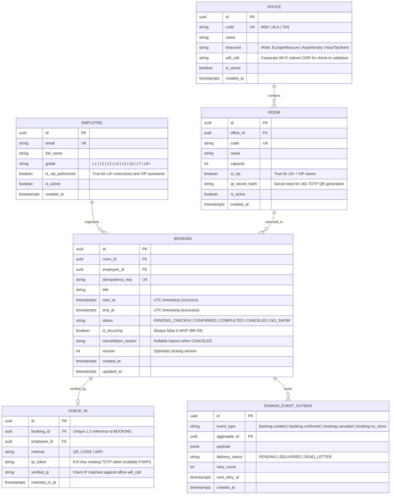
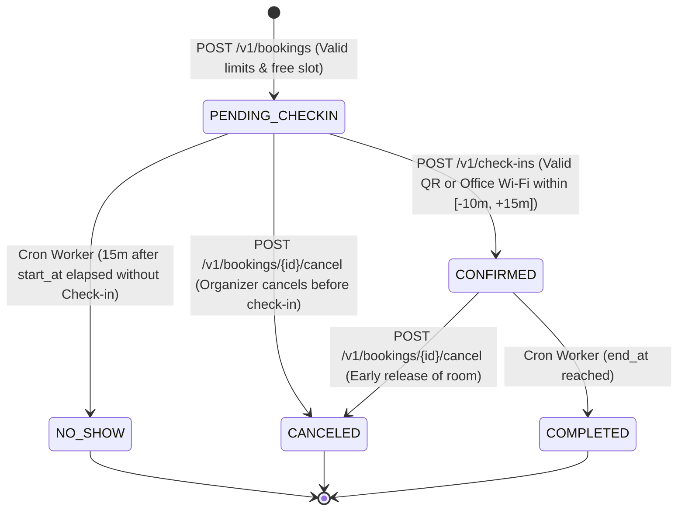

# System Architecture & Data Model: Smart Room Booking (`room_booking`)

> **Document Status:** Verified (Orchestrator Approved)  
> **Version:** 1.0  
> **Related BRD:** `01_BRD.md`  
> **Related API Contract:** `03_OpenAPI.yaml`  
> **Pipeline Pattern:** Orchestrator-Worker (Worker: `gemini-3.5-flash-lite`, Critic: `Gemini 4 Argon`)

---

## 1. Architectural Overview & Design Principles
### 1.1 Architectural Style & Patterns
Сервис **Smart Room Booking** спроектирован по принципу **Modular Domain Service + Event-Driven Outbox**, где собственная база данных PostgreSQL выступает единственным источником истины (*Single Source of Truth*) для расписания всех переговорных комнат в Москве, Алматы и Ташкенте.

Ключевые архитектурные паттерны:
- **Database-Level Interval Exclusion (`EXCLUDE USING gist`):** Физическая защита от *Double Booking* на уровне ядра PostgreSQL с использованием типа `tstzrange(start_at, end_at, '[)')` (включая начало, исключая конец, чтобы бронь `14:00–15:00` не конфликтовала с `15:00–16:00`).
- **Cryptographic TOTP QR & Office Wi-Fi CIDR Verification:** Защита процедуры Check-in от удаленного спуфинга. Планшет у двери генерирует 30-секундный токен `HMAC-SHA256(room_qr_secret, floor(unix_time / 30))`, либо бэкенд сверяет IP-адрес клиента с белым списком корпоративных Wi-Fi подсетей целевого офиса.
- **Transactional Outbox Pattern:** Атомарная запись доменных событий (`booking.created`, `booking.confirmed`, `booking.canceled`, `booking.no_show`) в таблицу `DOMAIN_EVENT_OUTBOX` в рамках одной транзакции с изменением брони для гарантированной доставки `.ics` инвайтов в Google Calendar и MS Exchange.
- **Idempotency-Key Engine:** Кэширование мутирующих `POST`-запросов по заголовку `Idempotency-Key` (UUID v4, TTL 24 часа) для защиты от дублей при плохом мобильном интернете.

### 1.2 System Components & Responsibilities
| Component | Layer / Technology | Core Responsibility |
| :--- | :--- | :--- |
| **API Gateway / Ingress** | Nginx / Envoy | TLS 1.3 терминация, аутентификация JWT (SSO), передача заголовка `X-Forwarded-For` для проверки офисного Wi-Fi, rate-limiting. |
| **Booking Core Service** | Python 3.12 / FastAPI (или Go) | Валидация бизнес-правил (`BR-01`..`BR-05`), проверка прав VIP (`L8+` / `is_vip_authorized`), верификация Check-in (`QR_CODE` / `WIFI`), управление транзакциями. |
| **No-Show & Lifecycle Scheduler** | Background Cron Worker | Ежеминутный поиск броней со статусом `PENDING_CHECKIN`, у которых `NOW() >= start_at + 15m`, перевод их в `NO_SHOW` и перевод завершенных встреч в `COMPLETED`. |
| **Calendar Outbox Dispatcher** | Async Worker | Выборка `PENDING` событий из `DOMAIN_EVENT_OUTBOX` (`FOR UPDATE SKIP LOCKED`), отправка `.ics` / вебхуков в Google Calendar и MS Exchange с экспоненциальным backoff. |
| **PostgreSQL 16 (`btree_gist`)** | Primary Relational DB | Хранение сущностей, инвариант непересечения временных слотов `tstzrange`, хранение дат в UTC (`timestamptz`). |

---

## 2. Entity-Relationship Diagram (ERD)
> [!IMPORTANT]
> Все сущности, названия полей, типы данных и перечисления статусов (`enum`) на 100% синхронизированы со схемами в `03_OpenAPI.yaml`.



### SQL-инвариант защиты от Double Booking (`BR-05`)
```sql
CREATE EXTENSION IF NOT EXISTS btree_gist;

ALTER TABLE booking
ADD CONSTRAINT excl_booking_no_overlap
EXCLUDE USING gist (
    room_id WITH =,
    tstzrange(start_at, end_at, '[)') WITH &&
)
WHERE (status IN ('PENDING_CHECKIN', 'CONFIRMED'));
```
Полуинтервал `'[)'` гарантирует, что встреча `14:00–15:00` и следующая за ней встреча `15:00–16:00` **не считаются пересекающимися**, но любое наложение хотя бы на 1 секунду внутри интервала блокируется ядром СУБД.

---

## 3. Booking Aggregate Lifecycle (State Machine)


---

## 4. Core Sequence Diagrams
### 4.1 Создание бронирования и защита от гонок (Double Booking Prevention)
```mermaid
sequenceDiagram
    autonumber
    actor User as Employee (Client App)
    participant Gateway as API Gateway
    participant Service as Booking Core Service
    participant DB as PostgreSQL (GIST)
    participant Outbox as Outbox Dispatcher

    User->>Gateway: POST /v1/bookings (Idempotency-Key, room_id, start_at, end_at)
    Gateway->>Service: Forward request + JWT claims
    activate Service
    Service->>DB: Check Idempotency-Key
    Service->>DB: Load ROOM (is_vip, office.timezone) & EMPLOYEE (grade, is_vip_authorized)
    Service->>Service: Validate BR-01 (<=120m, <=14d), BR-02 (VIP access), BR-03 (is_recurring=false)
    alt Business Rule Violated
        Service-->>Gateway: 422 Unprocessable Entity (ProblemDetails)
        Gateway-->>User: 422 Error (EXCEEDS_MAX_DURATION / VIP_ACCESS_REQUIRED)
    else Rules Passed
        Service->>DB: BEGIN; INSERT INTO booking (...) + INSERT INTO domain_event_outbox (...)
        alt Concurrent Overlapping Slot (GIST Exclusion Violation 23P01)
            DB-->>Service: ERROR 23P01 exclusion_violation
            Service-->>Gateway: 409 Conflict (error_code=ROOM_SLOT_OVERLAP)
            Gateway-->>User: 409 Conflict
        else Commit Succeeded
            DB-->>Service: 201 Committed (status=PENDING_CHECKIN)
            Service-->>Gateway: 201 Created (BookingResponse)
            Gateway-->>User: 201 Created
        end
    end
    deactivate Service
```

### 4.2 Процедура Check-in, автоматический `NO_SHOW` и синхронизация с календарем
```mermaid
sequenceDiagram
    autonumber
    actor User as Employee (Organizer)
    participant Tablet as Room Tablet (Door UI)
    participant Service as Booking Core Service
    participant Cron as No-Show Scheduler
    participant DB as PostgreSQL
    participant Outbox as Calendar Outbox Worker
    participant Cal as Google Calendar / MS Exchange

    alt Organizer Performs Check-in Within 15 Minutes
        Tablet-->>User: Display rotating 30s TOTP QR Code (qr_token)
        User->>Service: POST /v1/check-ins (booking_id, method=QR_CODE, qr_token)
        Service->>DB: SELECT booking FOR UPDATE
        Service->>Service: Verify window [start_at-10m, start_at+15m] & validate TOTP qr_token
        Service->>DB: INSERT check_in; UPDATE booking SET status='CONFIRMED'; INSERT outbox('booking.confirmed')
        Service-->>User: 201 Created (CheckInResponse)
    else 15 Minutes Elapsed Without Check-in (Ghost Booking)
        Cron->>DB: SELECT * FROM booking WHERE status='PENDING_CHECKIN' AND NOW() >= start_at + INTERVAL '15 minutes' FOR UPDATE SKIP LOCKED
        Cron->>DB: UPDATE booking SET status='NO_SHOW'; INSERT outbox('booking.no_show')
    end

    Outbox->>DB: Poll PENDING events from domain_event_outbox
    Outbox->>Cal: Send .ics update / Webhook (X-Webhook-Signature: HMAC-SHA256)
    Cal-->>Outbox: 200 OK
    Outbox->>DB: UPDATE domain_event_outbox SET delivery_status='DELIVERED'
```

---

## 5. Architectural & Data Consistency Decisions
| Decision Area | Chosen Approach | Rationale |
| :--- | :--- | :--- |
| **Time Representation** | `TIMESTAMPTZ` (UTC) в БД + IANA `timezone` (`Europe/Moscow`, `Asia/Almaty`, `Asia/Tashkent`) в `OFFICE`. | Полностью устраняет баг смещения времени при бронировании комнат между офисами в разных странах. |
| **Double Booking Prevention** | PostgreSQL `EXCLUDE USING gist` по полуинтервалу `tstzrange(start_at, end_at, '[)')` для активных статусов. | Атомарная гарантия на уровне ядра СУБД; стыкующиеся встречи (`14:00–15:00` и `15:00–16:00`) разрешены благодаря полуинтервалу `'[)'`, а пересекающиеся — невозможны. |
| **Anti-Spoofing Check-in** | TOTP `qr_token` (ротация 30 сек) при `method=QR_CODE` ИЛИ сверка `verified_ip` с `office.wifi_cidr` при `method=WIFI`. | Выполняет требование ИБ без полугодовой интеграции со СКУД и биометрией. |
| **VIP Governance** | Флаг `ROOM.is_vip` + атрибуты `EMPLOYEE.grade` и `EMPLOYEE.is_vip_authorized`. | Защищает обычных сотрудников от принудительного выселения и дает топ-менеджменту гарантированный ресурс для длительных совещаний. |
| **Calendar Integration** | Асинхронный **Transactional Outbox** с экспоненциальным backoff и `DEAD_LETTER`. | Внешние сбои Google/Exchange никогда не ломают и не замедляют внутренний сервис бронирования. |
