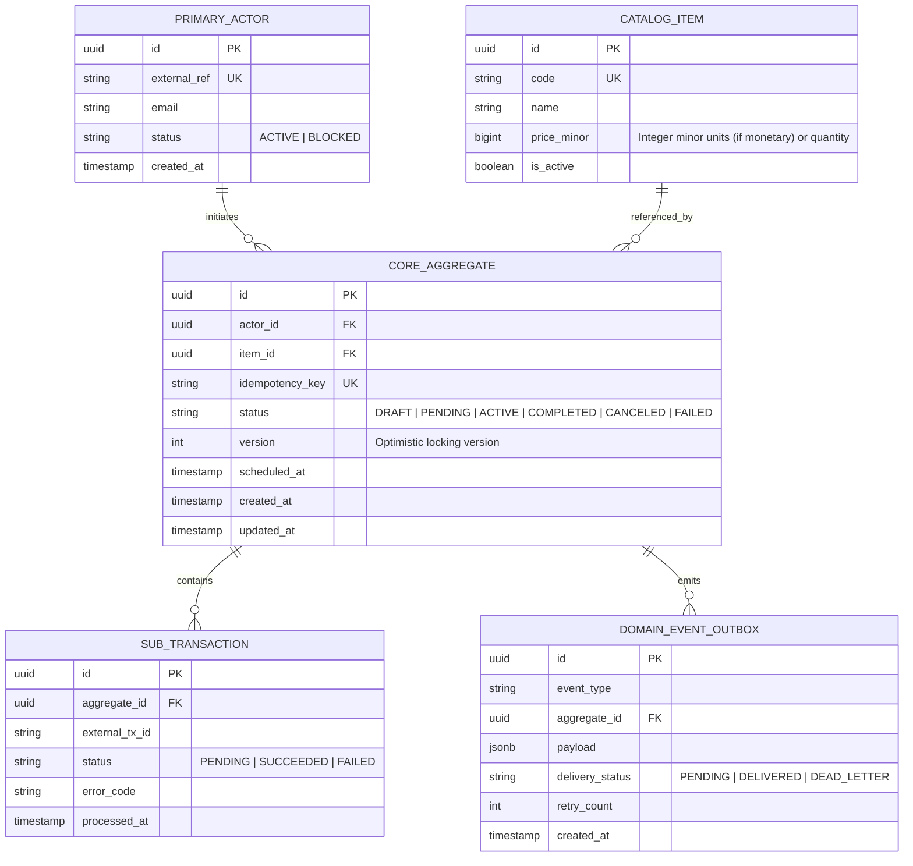
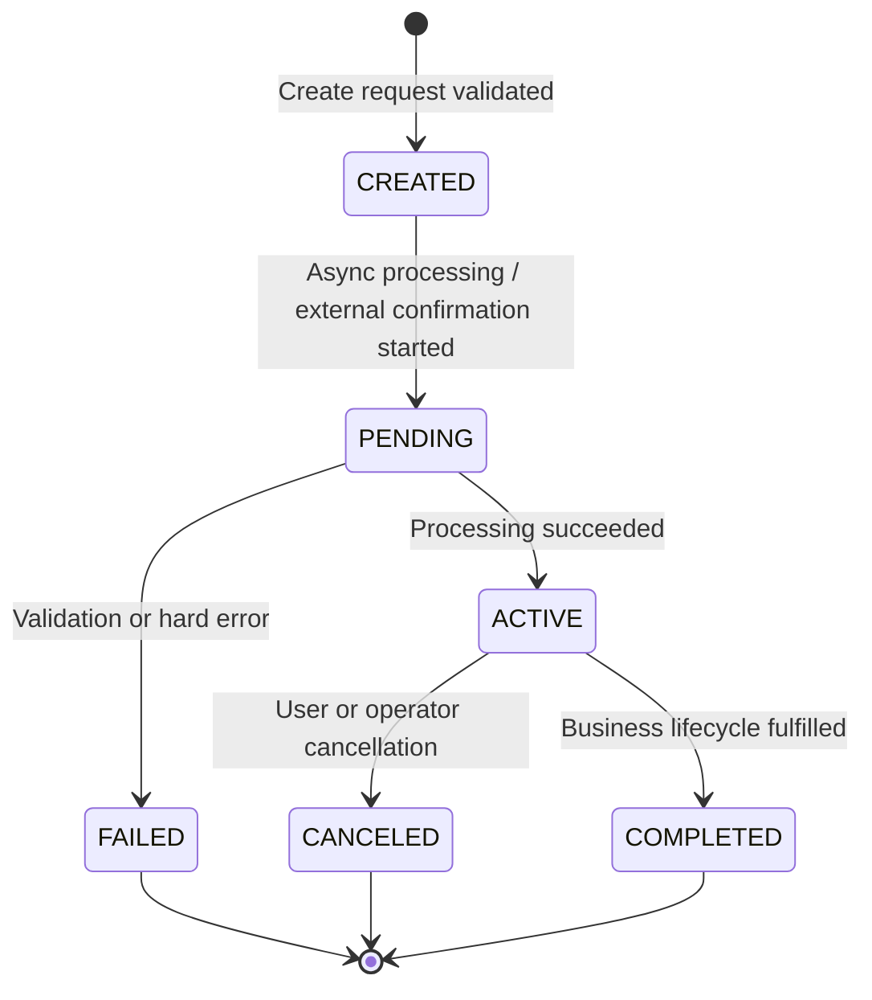
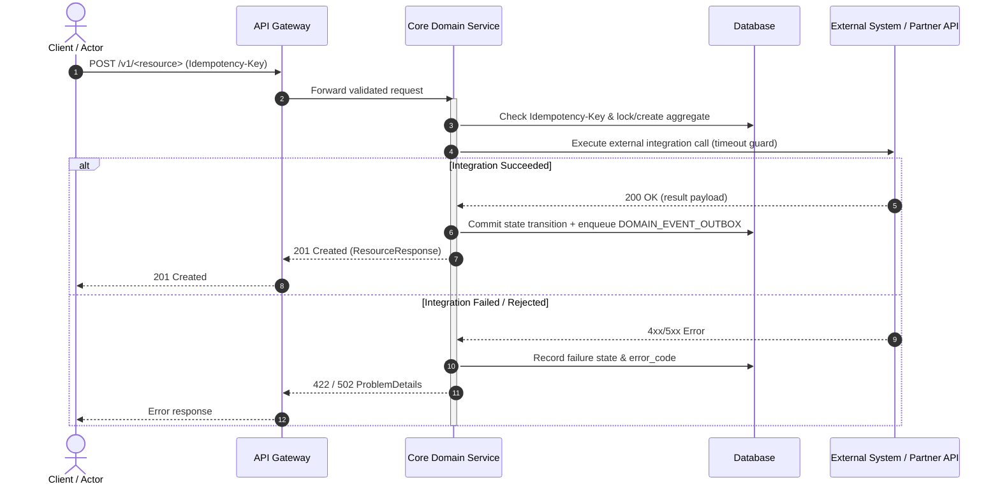
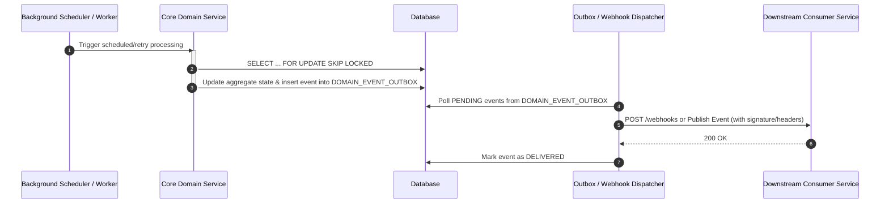

# System Architecture & Data Model: {{PROJECT_NAME}}

> **Document Status:** Draft / Verified  
> **Version:** 1.0  
> **Related BRD:** `01_BRD.md`  
> **Related API Contract:** `03_OpenAPI.yaml`

---

## 1. Architectural Overview & Design Principles
### 1.1 Architectural Style & Patterns
<!-- Опишите выбранный архитектурный стиль и ключевые паттерны надежности под предметную область проекта (например: синхронный REST vs асинхронные события, Transactional Outbox, Idempotency-Key, Optimistic/Pessimistic Locking, State Machine, кэширование). -->

### 1.2 System Components & Responsibilities
| Component | Layer / Technology | Core Responsibility |
| :--- | :--- | :--- |
| **API Gateway / BFF** | <!-- API Layer --> | <!-- Маршрутизация, авторизация, валидация, rate-limiting --> |
| **Core Domain Service** | <!-- Application Layer --> | <!-- Ядро бизнес-логики, инварианты BR-*, переходы состояний --> |
| **Integration Adapter / Worker** | <!-- Infrastructure Layer --> | <!-- Взаимодействие с внешними системами, фоновые задачи, ретраи --> |
| **Primary Database** | <!-- Storage Layer --> | <!-- Хранение доменных сущностей и транзакционная целостность --> |
| **Event Bus / Outbox Dispatcher** | <!-- Messaging Layer --> | <!-- Доставка доменных событий и уведомлений смежным сервисам --> |

---

## 2. Entity-Relationship Diagram (ERD)
> [!IMPORTANT]
> Все сущности, названия полей, типы данных, первичные (`PK`), внешние (`FK`) и уникальные (`UK`) ключи ДОЛЖНЫ строго совпадать со схемами в `03_OpenAPI.yaml`.

<!-- ЗАМЕНИТЕ примерные сущности выше на реальные доменные сущности анализируемого проекта! -->

---

## 3. Core Aggregate Lifecycle (State Machine)

<!-- Адаптируйте состояния и переходы под жизненный цикл главной сущности проекта и синхронизируйте с enum в 03_OpenAPI.yaml! -->

---

## 4. Core Sequence Diagrams
### 4.1 Primary Happy Path & External Integration Flow

### 4.2 Background Processing, Retry / Compensation & Event Delivery Flow

---

## 5. Architectural & Data Consistency Decisions
| Decision Area | Chosen Approach | Rationale |
| :--- | :--- | :--- |
| **Data Types & Precision** | <!-- Например: целочисленные минорные единицы для денег, UTC ISO-8601 для дат, UUID v4 для PK --> | <!-- Обоснование --> |
| **Concurrency & Race Conditions** | <!-- Например: SELECT FOR UPDATE / Optimistic Locking (version) --> | <!-- Обоснование --> |
| **Idempotency & Retries** | <!-- Например: заголовок Idempotency-Key + таблица ключей с TTL 24h --> | <!-- Обоснование --> |
| **Security & PII Protection** | <!-- Например: шифрование/токенизация, маскирование в логах, RBAC --> | <!-- Обоснование --> |
| **Asynchronous Reliability** | <!-- Например: Transactional Outbox + Dead Letter Queue --> | <!-- Обоснование --> |
